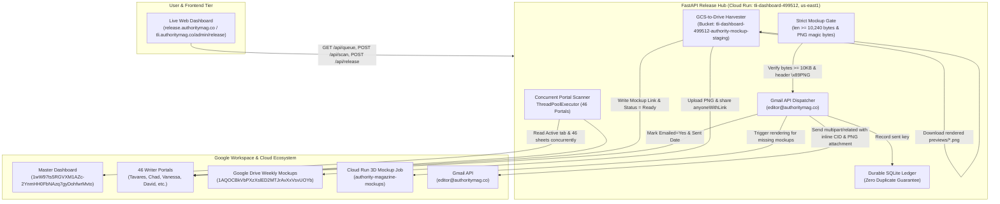

# Implementation Plan: Authority Magazine Friday Release Hub Deployment

## Goal Description
Deploy the **Authority Magazine Friday Release Hub** (FastAPI backend + Live Web Dashboard) on Google Cloud Run (`tli-dashboard-499512`, region `us-east1`), and integrate it with the existing GitHub repository (`PaulPachad/TLI-Dashboard`) and Vercel production deployment (`https://tli.authoritymag.co`).

This replaces the 6-minute Google Apps Script loop (`MockupBridge.gs` / `continueAuthorityMockups`) that previously timed out, looped on `report.results`, and risked sending follow-up emails without verified 3D mockups. The FastAPI hub guarantees 60-minute continuous execution (`--timeout=3600`), 3-second parallel portal scanning, direct GCS-to-Google-Drive mockup harvesting, and a strict mathematical mockup-first email gate (`>= 10,240` bytes + valid PNG magic bytes) for both Live and Follow-Up emails.

---

## Architecture Overview



---

## User Review Required

> [!IMPORTANT]
> **Authentication Scopes & Service Account Permissions**
> 1. Cloud Run runs under the default Compute Service Account (`tli-dashboard-499512-compute@developer.gserviceaccount.com`) or a dedicated service account.
> 2. For Google Sheets and Drive access, the Service Account email must have **Editor** access to:
>    - Master Sheet: `1wW97ts5RGVXM1AZc-2YnmHH0FbNAzq7gyDohfwrMvto`
>    - Google Drive `Weekly Mockups` folder: `1AQOCBkVbPXzXslED2MTJrAvXxVsvUOYb`
>    *(Alternatively, the service can use the existing OAuth Refresh Token for `editor@authoritymag.co` which already has full access).*
> 3. For sending emails from `editor@authoritymag.co`, we will pass `GOOGLE_CLIENT_ID`, `GOOGLE_CLIENT_SECRET`, and `GOOGLE_REFRESH_TOKEN` (extracted from the existing `token_editor.json` in `auto-responder`) as environment variables to Cloud Run.

> [!WARNING]
> **Domain Mapping for `release.authoritymag.co`**
> Cloud Run custom domain mappings require a CNAME record in your `authoritymag.co` DNS provider (Cloudflare, GoDaddy, Namecheap, etc.):
> - **Type**: `CNAME`
> - **Name / Host**: `release`
> - **Target / Value**: `ghs.googlehosted.com.`

---

## Open Questions

> [!NOTE]
> 1. **Follow-Up Email Delay Window**: The default delay is set to 4 days (`FOLLOW_UP_DELAY_DAYS = 4`). Does this match your desired schedule for sending follow-up emails after an interview goes live?
> 2. **Shopify Order Check**: For follow-ups, if a recipient already purchased a plaque or reprint, should we check the writer portal's `Shopify Purchase Status` column, or do you have active Shopify Store API credentials to check live orders? (Default is to check the sheet column and skip if `"PURCHASED"`).

---

## Proposed Changes

### Component 1: FastAPI Backend (`authority_release_hub/main.py`)
Enhance the existing script from `authority_release_hub.zip` to fully implement all required routes and strict safety guarantees.

#### [MODIFY] `authority_release_hub/main.py`
- **Add Route `GET /api/queue`**:
  Returns current queue items, summary metrics, and status to match frontend requirements.
- **Add Route `POST /api/send-row`**:
  Accepts `{ "portal_id": str, "row_number": int, "type": "live" | "followup" }`.
  Downloads and strictly verifies 3D Mockup bytes (`>= 10,240 bytes` and `b'\x89PNG\r\n\x1a\n'`). If invalid, rejects with 400. If valid, builds MIME email, dispatches via Gmail API, updates sheet, and records in SQLite ledger.
- **Implement Email Dispatch & Mockup Render Logic in `run_scan_and_sync_pipeline`**:
  When `send_emails=True` (triggered via `POST /api/release`):
  1. **Phase 1: GCS-to-Drive Sync**: Scans `gs://tli-dashboard-499512-authority-mockup-staging/previews/` and copies all matched PNGs into Google Drive `Weekly Mockups` folder (`1AQOCBkVbPXzXslED2MTJrAvXxVsvUOYb`), setting public read permissions (`anyoneWithLink`). Updates writer portal cells with `Mockup Link` and `Mockup Status = "Ready"`.
  2. **Phase 2: Strict Live Email Dispatch**:
     - Loops through all live rows ready to email.
     - Downloads PNG bytes from Drive or GCS.
     - Verifies: `len(png_bytes) >= 10240` and magic bytes match PNG signature.
     - If verified:
       - Checks SQLite ledger & Gmail sent search to ensure zero duplicate sending.
       - Builds RFC 2822 `multipart/related` MIME email with inline `cid:mockupPreview` and `Authority-Magazine-3D-Mockup.png` attachment.
       - Dispatches via Gmail API as `editor@authoritymag.co`.
       - Updates writer portal: `Emailed = "Yes"`, `Live Email Sent Date = now()`, `Live Email Status = "Sent (With 3D Mockup)"`.
       - Records in SQLite `sent_ledger` and appends to `_Authority Press Run Report` on Master Sheet.
     - If not verified:
       - Sets `Live Email Status = "Held: Waiting for 3D Mockup"`. Leaves `Emailed` blank / `No`.
  3. **Phase 3: Trigger Mockup Rendering for Missing Items**:
     - For rows where no mockup exists in Drive or GCS, extracts portal IDs and triggers Cloud Run Job `authority-magazine-mockups` in batches of 12 via `https://run.googleapis.com/v2/projects/{GCP_PROJECT}/locations/{GCP_REGION}/jobs/{CLOUD_RUN_JOB}:run`.
  4. **Phase 4: Strict Follow-Up Email Dispatch**:
     - Scans for rows where `isLive && sendYes && emailedYes && liveEmailSentDate && !followUpSentDate`.
     - Validates elapsed time `>= FOLLOW_UP_DELAY_DAYS` (4 days).
     - Checks Shopify purchase status.
     - Strictly verifies 3D Mockup PNG (`>= 10,240 bytes`). If missing, marks `Press Follow-Up Status = "Held: Waiting for 3D Mockup"`.
     - If verified, sends follow-up email with 3D mockup attached and embedded, sets `Press Follow-Up Sent Date = now()` and `Press Follow-Up Status = "Sent (With 3D Mockup)"`.
  5. **Phase 5: Completion Report**:
     - Sends detailed summary email to `rabbiweiner@gmail.com`.

---

### Component 2: Frontend Dashboard (`authority_release_hub/static/index.html`)

#### [MODIFY] `authority_release_hub/static/index.html`
- **Dynamic API Base Resolution**:
  Change hardcoded origin checks (`window.location.hostname.includes('authoritymag')`) to use relative paths (`/api/status`, `/api/scan`, `/api/release`, `/api/queue`, `/api/send-row`) so the dashboard works out-of-the-box on `localhost`, Cloud Run default domains (`*.run.app`), and custom domains (`release.authoritymag.co`).
- **Interactive Row-Level Send Button**:
  Add a "Send Now" button for each row in the table that invokes `POST /api/send-row`.
- **Live WebSocket / Polling Stream**:
  Poll `/api/status` every 2 seconds during active runs to display live terminal logs, progress bars, and updated KPI counters.

---

### Component 3: Integration with `TLI-Dashboard` (`tli.authoritymag.co`) & GitHub

#### [NEW] `C:\Users\Yitzi\OneDrive\Documents\Authority Mag SAAS\tli-leverage-dashboard\services\authority-release-hub\`
- Copy the complete, tested FastAPI service into `services/authority-release-hub/` inside `tli-leverage-dashboard`.
- Keep Dockerfile, requirements.txt, main.py, and static assets version-controlled in git.

#### [NEW] `tli-leverage-dashboard/src/app/(admin)/admin/release/page.tsx`
- Add an Admin page within the Next.js app (`/admin/release`) that embeds the Release Hub dashboard via responsive iframe or direct proxy, and adds a direct link in the admin navigation bar next to "Operations" and "Automation".

#### [MODIFY] `tli-leverage-dashboard/src/components/admin/operations-center.tsx`
- Add a prominent "Friday Release Hub" banner / link directing the team to `https://release.authoritymag.co` (or `/admin/release`).

---

### Component 4: Deployment & GitHub / Vercel Push

1. **Git Commit & Push**:
   - Stage changes in `tli-leverage-dashboard`.
   - Commit: `feat: integrate Authority Magazine Friday Release Hub (FastAPI + Cloud Run)`
   - Push to `origin/main` (`https://github.com/PaulPachad/TLI-Dashboard.git`).
2. **Vercel Production Deployment**:
   - Run `cmd /c "npx --yes vercel --prod --yes"` in `tli-leverage-dashboard`.
   - Verify live at `https://tli.authoritymag.co/admin/release`.
3. **Cloud Run Deployment**:
   - Provide automated build and deployment commands:
     ```bash
     gcloud run deploy authority-release-hub \
       --source services/authority-release-hub \
       --project tli-dashboard-499512 \
       --region us-east1 \
       --timeout=3600 \
       --cpu=2 \
       --memory=2Gi \
       --allow-unauthenticated \
       --set-env-vars="GCP_PROJECT=tli-dashboard-499512,GCP_REGION=us-east1,CLOUD_RUN_JOB=authority-magazine-mockups,GCS_BUCKET=tli-dashboard-499512-authority-mockup-staging,DRIVE_MOCKUP_FOLDER_ID=1AQOCBkVbPXzXslED2MTJrAvXxVsvUOYb,MASTER_SPREADSHEET_ID=1wW97ts5RGVXM1AZc-2YnmHH0FbNAzq7gyDohfwrMvto,SENDER_EMAIL=editor@authoritymag.co,REPORT_RECIPIENT=rabbiweiner@gmail.com"
     ```

---

## Verification Plan

### Automated Tests
1. **FastAPI Route & Schema Validation**:
   - Run local unit tests verifying route responses (`/`, `/api/status`, `/api/queue`, `/api/scan`, `/api/send-row`).
2. **Strict Mockup-First Guard Test**:
   - Verify that passing `<10 KB` bytes or non-PNG bytes to `build_strict_mockup_mime_message()` raises a `ValueError` and prevents email transmission.
3. **TypeScript / Next.js Build**:
   - Run `npm run build` in `tli-leverage-dashboard` to verify clean compilation with the new admin release route.

### Manual Verification
1. Access `https://tli.authoritymag.co/admin/release` and confirm the Release Hub dashboard loads.
2. Click "Scan Portals & Sync GCS" in the dashboard; verify in real-time that:
   - Portal scanning discovers un-emailed live rows across writer portals.
   - Any rendered PNGs in `gs://.../previews/` are copied to Google Drive `Weekly Mockups` folder `1AQOCBkVbPXzXslED2MTJrAvXxVsvUOYb`.
   - The queue displays each item's status clearly (`Ready in Drive`, `Ready in GCS`, or `Needs Render`).
3. Click "Send Row" for a single test item with a verified mockup; verify:
   - Recipient receives an email with the 3D mockup displayed inline and attached as a file.
   - The writer portal row is updated (`Emailed = Yes`, `Live Email Sent Date = now()`, `Live Email Status = Sent (With 3D Mockup)`).
   - Duplicate send attempt is caught by the SQLite ledger guard.
